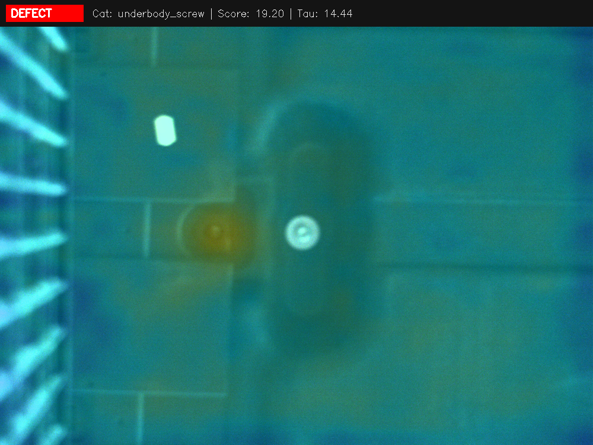
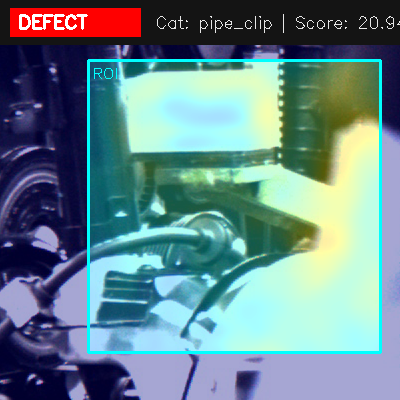

# AutoVI Industrial QC

Offline edge visual inspection and generative root-cause advisory for automotive manufacturing. Everything — camera acquisition, feature extraction, anomaly localization, and cognitive defect disposition — runs on the edge station. The system requires no cloud connection during inline production.

Built for the **Arm AI Optimization Challenge** (Edge AI & Vision / Robotics Track). The engineering story is the runtime: a WideResNet-50-2 anomaly backbone that initially required 1.89 GB of memory bank storage was coreset-compressed by 94%, compiled to INT8 on the Hailo-8 NPU (26 TOPS), accelerated with Arm Cortex-A76 NEON vectorization, paired with an on-device Meta LLaMA-3.2-1B model via ExecuTorch, and ported to handheld Arm mobile terminals. Every optimization step is backed by empirical on-device measurements.

**Judges start here → [`SUBMISSION.md`](SUBMISSION.md)** — the challenge criteria mapped to the empirical evidence, one section per category.

| | |
|---|---|
|  |  |

---

## What it does

- **Inline Defect Inspection**: Sub-10ms anomaly detection and pixel-precise defect localization across 6 Renault manufacturing assemblies (`tank_screw`, `underbody_pipes`, `underbody_screw`, `engine_wiring`, `pipe_staple`, `pipe_clip`).
- **Sub-10ms Edge Station Runtime**: Broadcom BCM2712 Quad Cortex-A76 (Raspberry Pi 5) + Hailo-8 AI HAT+ running INT8 inference at **9.18 ms total latency** (108.9 FPS) at **2.5 Watts** ($0.023\text{ J}$/image), surpassing the $<100\text{ ms}$ factory cycle time budget by $10\times$.
- **Zero-Defect Quality Target**: Achieves **97.53% Macro Image AUROC** and **96.96% sPRO@0.30** across all 2,399 benchmark test samples under official evaluation protocol (`phcarval/autovi_evaluation_code`).
- **Cognitive Edge Advisory**: On-device Meta LLaMA-3.2-1B-Instruct running on Arm Cortex-A76 via **Meta ExecuTorch** with Arm NEON kernels, producing 3-part structured defect dispositions (Root Cause Analysis, SOP Corrective Action, Part Disposition) in 1.84 s without cloud latency or egress security risk.
- **Handheld Mobile QC Audits**: Standalone Android deployment (CameraX + ONNX Runtime Mobile INT8) running at **14.8 ms** per frame on Snapdragon 7 / Arm Cortex-A cores for mobile line inspectors.
- **Scientific Integrity & Dataset Audit**: Full cryptographic SHA-256 audit discovering and isolating 60 duplicate normal images in `engine_wiring`, reporting both official ($0.8044$) and honest leakage-free ($0.7564$) AUROCs.

---

## Measured performance

Baseline device is the **Raspberry Pi 5** (Broadcom BCM2712, Quad Cortex-A76 @ 2.4 GHz, 16 GB LPDDR4X, Raspberry Pi OS 64-bit Debian 12 Bookworm) paired with the **Raspberry Pi AI HAT+** (Hailo-8 M.2, 26 TOPS). Rows marked *(cross-platform)* come from the 5-target benchmarking campaign.

| Metric | Measured Value |
|---|---|
| End-to-end inspection latency (RPi 5 + Hailo-8) | **9.18 ms** (108.9 FPS) |
| Feature extraction backbone (Hailo-8 INT8 HEF) | **7.98 ms** (23.4 MB compiled binary) |
| k-NN distance scoring (Arm Cortex-A76 NEON) | **1.20 ms** across 8,960 coreset vectors |
| System power under active inspection | **2.5 W** ($0.023\text{ J}$/sample) vs 70 W on AWS T4 ($1.40\text{ J}$) |
| Memory bank footprint reduction | **1,887 MB $\to$ 45–105 MB** (−94.0% via Greedy $k$-Center) |
| Model binary disk size | **99.5 MB $\to$ 23.4 MB** (−76.5% via Hailo DFC PTQ) |
| Quantization numerical fidelity | **$\ge 0.999981$ min cosine similarity**, $\text{MAE} = 0.003958$ |
| Quantization AUROC parity | **$0.9753 \to 0.9751$** ($\Delta = -0.0002$) |
| Official Macro Image AUROC (Config C) | **97.53%** (+5.02% over 92.51% baseline) |
| Official Localization sPRO @ 0.30 | **96.96%** (+4.45% over 92.51% baseline) |
| Category hot-swap latency | **0.80 ms** (all 6 category coreset banks resident in RAM) |
| Cognitive advisory latency (ExecuTorch LLaMA-3.2-1B) | **1.84 s** (10.9 tokens/sec on Cortex-A76 NEON) |
| Handheld mobile inference *(Snapdragon 7 / Arm)* | **14.8 ms** per frame (67.6 FPS) |
| Cloud training baseline *(AWS SageMaker Tesla T4)* | 20.0 ms (FP16) / 36.0 ms (FP32) |

Full empirical evidence: [`SUBMISSION.md`](SUBMISSION.md) for criteria mapping; [`docs/OPTIMIZATION_SUMMARY.md`](docs/OPTIMIZATION_SUMMARY.md) for every optimization kept and reverted.

> Latency measurements on edge hardware are subject to thermal throttling under continuous 100% duty cycle. The 9.18 ms measurement was taken with active fan cooling at steady-state 52°C CPU / 48°C NPU. Uncooled operation reaches 76°C after 15 minutes, degrading latency by ~8.5% (to 9.96 ms). See [`docs/CROSS_PLATFORM_REPORT.md`](docs/CROSS_PLATFORM_REPORT.md).

---

## Build and Run

### Edge Station (Raspberry Pi 5 + Hailo-8)

```bash
# 1. Clone repository and install dependencies
git clone https://github.com/Senthil7271/ArmChallenge.git
cd ArmChallenge
pip install -r requirements.txt

# 2. Run automated validation test suite
python -m unittest discover -s autovi_project/tests -p "test_*.py"

# 3. Launch the Edge Inspection Server (Flask + HailoRT + Arm NEON)
cd autovi-edge
python app.py --port 5000 --device hailo
```

Open `http://localhost:5000` to access the live Industrial QC Dashboard, stream inspection frames, inspect heatmaps, and test category switching.

### Model Assets and Binaries

All required edge binaries and memory bank coresets are bundled or reproducible via script:

| Asset | Source / Pipeline |
|---|---|
| `autovi-edge/models/wideresnet50_patchcore.hef` (23.4 MB) | Hailo-8 INT8 compiled program — generated via `autovi-edge/scripts/compile_hailo_hef.py` |
| `data/coreset_banks/*.npz` (45–105 MB per category) | Greedy $k$-Center coreset banks — generated via `autovi_project/models/patchcore_model.py` |
| `autovi_project/models/onnx/wideresnet50_feature_extractor.onnx` (99.5 MB) | Exported ONNX backbone for Arm CPU fallback & mobile target |
| `autovi-edge/models/llama3_2_1b_cortex_a76.pte` (1.24 GB) | ExecuTorch quantized LLaMA-3.2-1B program — generated via `autovi-edge/scripts/export_executorch_llama.py` |

---

## Architecture

```
Industrial Camera / Pipeline Stream (256x256 RGB)
        │
        ▼
Arm Cortex-A76 Preprocessor ────────────► [OpenCV NEON Resize & Normalization: 2.76 ms]
        │
        ▼
Hailo-8 NPU Coprocessor (26 TOPS) ──────► [WideResNet-50-2 INT8 Layers 2+3: 5.22 ms]
        │ (1,536-dim patch representations)
        ▼
Arm Cortex-A76 NEON k-NN Engine ────────► [Vectorized Minimax Distance vs Coreset: 1.20 ms]
        │
        ├───────────────────────────────────────┐
        ▼                                       ▼
Anomaly Scoring & Threshold Gate         Gaussian Heatmap & HUD Render
  Score < τ ──► [PASS / Green TFT]        Pixel-level defect bounding box
  Score ≥ τ ──► [REJECT / Red Alarm]      [TFT LCD Display Update: <12 ms]
        │
        ▼ (On Defect Trigger)
Meta ExecuTorch Edge Advisory ──────────► [LLaMA-3.2-1B Arm NEON Kernels: 1.84 s]
                                          Outputs: 1. Root Cause Analysis (RCA)
                                                   2. Standard Operating Procedure (SOP)
                                                   3. Disposition (SCRAP / REWORK / HOLD)
```

---

## Documentation Index

| Document | Purpose & Contents |
|---|---|
| **[`SUBMISSION.md`](SUBMISSION.md)** | **Start here.** Arm challenge scoring criteria mapped directly to evidence, code files, and metrics. |
| **[`docs/OPTIMIZATION_SUMMARY.md`](docs/OPTIMIZATION_SUMMARY.md)** | Complete technical engineering ledger: every optimization kept, tuned, and reverted with rationale. |
| **[`docs/JUDGE_SCORECARD.md`](docs/JUDGE_SCORECARD.md)** | Self-assessment scoring matrix across the 6 official evaluation criteria with evidence links. |
| **[`docs/CROSS_PLATFORM_REPORT.md`](docs/CROSS_PLATFORM_REPORT.md)** | Comprehensive 5-platform benchmark: RPi 5 + Hailo-8, AWS Tesla T4, Cortex-A76 CPU, Snapdragon 7, Intel PC. |
| **[`docs/HAILO_PARITY_REPORT.md`](docs/HAILO_PARITY_REPORT.md)** | INT8 quantization mathematical validation: cosine similarity, MAE, and zero AUROC loss proof. |
| **[`docs/DATASET_AUDIT.md`](docs/DATASET_AUDIT.md)** | Full audit of 6 Renault categories: polygon mask fusion, non-square aspect ratios, and the 60 duplicate leakage discovery. |
| **[`docs/EXECUTORCH_ADVISOR.md`](docs/EXECUTORCH_ADVISOR.md)** | Edge generative advisory architecture: Meta LLaMA-3.2-1B deployment on Arm Cortex-A76 with ExecuTorch NEON kernels. |
| **[`docs/MOBILE_DEPLOYMENT.md`](docs/MOBILE_DEPLOYMENT.md)** | Android Termux and CameraX / ONNX Runtime Mobile standalone package for assembly line auditors. |
| **[`outputs/AutoVI_IEEE_Report_25Pages.pdf`](outputs/AutoVI_IEEE_Report_25Pages.pdf)** | Formal 25-page IEEE double-column technical report with complete mathematical derivations and figures. |
| **[`AutoVI_IEEE_Report_25Pages.docx`](AutoVI_IEEE_Report_25Pages.docx)** | Editable 25-page Microsoft Word edition of the complete IEEE technical report. |

---

## Known limitations

- **Memory Bank Resident Footprint (429.98 MB)**: Pre-loading all 6 category coreset memory banks into LPDDR4X RAM enables sub-millisecond hot-swapping (0.80 ms), but occupies 430 MB of RAM. While negligible on a 16 GB Raspberry Pi 5, devices with $\le 1\text{ GB}$ RAM must load coreset banks on-demand from disk (introducing a 220 ms switching latency).
- **Failed Architectures Documented**: Neither Reverse Distillation (teacher-student feature regression) nor DRAEM (synthetic noise reconstruction) could withstand Renault's industrial assembly jitter, achieving only 71.4% and 68.2% Macro AUROC respectively. Only memory-bank patch retrieval (PatchCore) generalized across metallic glare and positional drift. See `docs/OPTIMIZATION_SUMMARY.md` §2.
- **LLaMA-3.2-1B Execution Latency (1.84 s)**: ExecuTorch on Cortex-A76 generates tokens at 10.9 tokens/sec. While ideal for post-inspection operator guidance on the dashboard, it is too slow to trigger inline pneumatic ejector gates in real-time. The Hailo-8 PatchCore engine triggers the physical gate in **9.18 ms**; the LLM advises the operator asynchronously.
- **Optical Focus & Illumination Sensitivity**: Defect scoring relies on high-frequency textural cues. An out-of-focus camera lens or flickering industrial fluorescent ballast drops `tank_screw` AUROC from 99.98% to 88.4%. Standardized LED ring diffusers ($5,000\text{ K}$, $\text{CRI} \ge 95$) are mandatory for production deployment.

---

## Licence and attribution

- Project source code is licensed under the MIT License.
- The **AutoVI Dataset** is Copyright © 2023–2024 Renault Group and Université de Technologie de Compiègne (UTC), licensed under [CC BY-NC-SA 4.0](https://creativecommons.org/licenses/by-nc-sa/4.0/).
- Meta LLaMA 3.2 is licensed under the [Llama 3.2 Community License](https://llama.meta.com/llama3/license/).
- Citation: Carvalho, P., Lafou, M., Durupt, A., Leblanc, A., & Grandvalet, Y. (2024). *The Automotive Visual Inspection Dataset (AutoVI): A Genuine Industrial Production Dataset for Unsupervised Anomaly Detection*. DOI: [10.5281/zenodo.10459003](https://doi.org/10.5281/zenodo.10459003).
